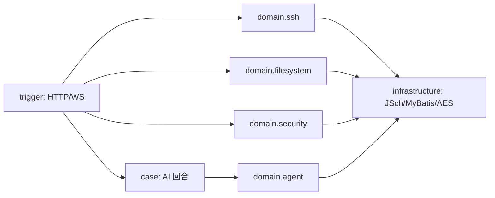

# ai-ssh-server 项目说明

## 项目概述

AI + SSH 的服务端项目，提供 SSH 连接管理、远程文件系统、操作审计与 AI 运维助手能力。基于 DDD 四层架构设计。

- **Spring Boot 4.1.0** + **MyBatis-Plus 3.5.16** + **MySQL 8.0**
- 包名：`jainingfei.site.ai.agent`
- 模块：api / domain / infrastructure / trigger / types / app / case
- 领域上下文：`ssh`（连接/终端）、`filesystem`（SFTP）、`security`（凭证加密/审计）、`agent`（ADK 装配）

## v3 升级要点（桌面本地模式 / 存储双模式 / 模型可配置）

- **存储双模式**：`application-local.yml`（默认：H2 文件库 `${AI_SSH_HOME}/data/ai-ssh` + `db/schema-h2.sql` 幂等建表）与 `application-server.yml`（MySQL，表结构走 `docs/dev-ops/mysql/sql`）。切换用 `AI_SSH_PROFILE` 或 `--spring.profiles.active`。
- **应用数据目录**：`AiSshHome`（infrastructure.config）在 `Application.main()` 里**先于** `SpringApplication.run` 解析并创建 `data/ config/ logs/`，把绝对路径（正斜杠）写回 `AI_SSH_HOME` 系统属性；`application-local.yml` 的 H2 URL、`spring.config.import`、`logging.path` 都依赖它。**`@SpringBootTest` 不经过 main()**，测试侧用 `src/test/resources/application-local.yml`（内存 H2 + 临时日志目录）覆盖同名 main 配置。
- **配置文件写接口**：`AgentConfigFileStore`（infrastructure.config）+ `AgentConfigController`（trigger，前缀 `/api/v1/agent/config`）：
  - `agent.yml`：主配置（智能体/子智能体/MCP/技能/运行治理），读/写时做 YAML 语法 + `ai.agent.config.tables` 结构校验，写前备份 `.bak`，临时文件 + 原子替换。
  - `llm.yml`：模型配置覆盖层，只写 `ai.agent.config.tables.<tableKey>.module.chat-model` 下的键；`spring.config.import` 顺序 `agent.yml` → `llm.yml`（同名键后者覆盖），所以表单保存不会重写 agent.yml、不会丢注释。
  - `api-key` 只写不读：GET 只回传 `apiKeyConfigured`；保存返回 `restartRequired=true`，重启后生效。
  - provider 取值唯一出处 `ProviderCapabilities`（`deepseek-native` / `openai-compatible`）；校验失败 `code=0002` + 原因。
- **桌面打包约束**：服务端必须能以 `--spring.profiles.active=local` 零外部依赖启动（`java -jar`），客户端 `scripts/bundle-backend.ps1` 会把 jar 与 jlink JRE 打进 Tauri resources。
- **表结构对齐**：本地 H2 与 MySQL 列级一致；v3 补齐 `chat_task_state`，存量库执行 `migration-v3.sql`（`init.sql` 已同步）。

## v2 升级要点（安全 / 文件 / 审计 / 配置）



- **凭证加密**：`ICredentialCipher`（domain.security）→ `AesGcmCredentialCipher`（infrastructure），AES-256-GCM + `enc:v1:` 前缀；创建/更新时加密，连接前解密；历史明文值原样兼容。
- **文件系统**：`IFileSystemService` + `RemotePathResolver` + `ISftpPort` → `JschSftpPort`；路径穿越/敏感目录/大小限额统一在领域服务拦截，所有写操作写审计。`rename` 同时承担移动：拒绝移动到自身/子目录、拒绝覆盖已存在目标，移动与重命名分别记 `FILE_MOVE` / `FILE_RENAME`。
- **操作审计**：`IAuditService` → `AuditService` + `AuditLogRepository`；`AuditContext`（ThreadLocal）由 `AuditContextFilter` 注入 userId/clientIp。
- **接口安全**：`SecurityProperties` + `ApiTokenFilter` + 全局 `CorsConfig`；WebSocket 握手与 HTTP 共用 CORS 白名单。
- **智能体增强**：`chat-model.temperature/max-tokens/top-p` 真正下发；`agents[].read-only` 决定是否挂载 `writeRemoteFile`；配置回传增加工具清单、运行治理参数与配置告警。
- **新增 AI 工具**：`listRemoteFiles` / `readRemoteFile` / `writeRemoteFile`，与 REST 文件系统复用同一领域服务。

### 核心 API（新增）

| 方法 | 端点 | 说明 |
|---|---|---|
| PUT | `/api/v1/ssh/connection/{id}` | 更新连接（部分更新，凭证留空保持） |
| GET | `/api/v1/ssh/connection/groups?userId=` | 分组统计 |
| GET | `/api/v1/sftp/{connectionId}/list` | 列目录 |
| GET | `/api/v1/sftp/{connectionId}/stat` | 文件属性 |
| GET | `/api/v1/sftp/{connectionId}/preview` | 文本预览（二进制识别） |
| GET | `/api/v1/sftp/{connectionId}/download` | 下载（流式） |
| POST | `/api/v1/sftp/{connectionId}/upload` | multipart 上传 |
| POST | `/api/v1/sftp/{connectionId}/mkdir|rename|delete|write` | 写操作（`rename` 同时承担移动） |
| GET | `/api/v1/audit/logs` | 审计分页（action/risk/connection 过滤） |
| GET | `/api/v1/audit/actions` | 审计动作字典 |
| GET | `/api/v1/system/overview` | 运行概览 |
| GET | `/api/v1/system/health` | 健康检查（默认免鉴权） |
| GET | `/api/v1/system/security` | 安全姿态（不含密钥） |

### 数据库（v2 新增）

- `ssh_connection` 新增：`group_name`、`tags`、`remark`、`favorite`、`last_connected_at`。
- 新增 `operation_audit_log`：用户/连接/动作/资源/明细/风险/成功/耗时/客户端 IP。
- 迁移脚本：`docs/dev-ops/mysql/sql/migration-v2.sql`；升级前 DDL 备份：`schema-backup-before-v2.sql`。

### 安全配置

```yaml
ai:
  security:
    auth-enabled: false
    credential-key: ${AI_SECURITY_CREDENTIAL_KEY:}
    api-token: ${AI_SECURITY_API_TOKEN:}
    sftp:
      max-upload-bytes: 104857600
      max-preview-bytes: 262144
      blocked-paths: [/proc, /sys, /dev]
    audit:
      enabled: true
```

### 测试

```bash
mvn -pl ai-ssh-server-app -am \
  "-Dtest=AesGcmCredentialCipherTest,RemotePathResolverTest,CommandGuardTest" \
  "-Dsurefire.failIfNoSpecifiedTests=false" test
```

## 总结存放要求

所有关于 ai-ssh-server 的学习总结、设计讨论、踩坑记录，统一存放在：

```
D:\docs\knowledge\ai-ssh\
```

以便集中查阅和管理。

**书写总结时必须遵循** `D:\docs\AGENTS.md` 中的编写规则——一篇一主题、模板结构（问题背景→核心方案→关键代码→踩坑记录）、互相引用、善用 Mermaid 图表。

## SSH 领域设计

SSH 连接框架用于统一管理 SSH 连接的生命周期：创建配置、建立连接、断开连接、查询列表、软删除。

详细总结见 `D:\docs\knowledge\ai-ssh\`：
- [SSH 库表设计取舍.md](D:\docs\knowledge\ai-ssh\SSH%20库表设计取舍.md) — 表拆分依据（访问频率×数据体积）、VO vs Entity 判定、MP 版本踩坑
- [SSH 领域 DDD 分层落地.md](D:\docs\knowledge\ai-ssh\SSH%20领域%20DDD%20分层落地.md) — 聚合设计、仓库/端口接口隔离、调用链路、踩坑记录
- [人机共用终端——统一会话层设计与实现.md](D:\docs\knowledge\ai-ssh\人机共用终端——统一会话层设计与实现.md) — WebSocket 和 AI 工具合并为一条终端通路，Marker 输出检测，写入锁

## AI Agent 踩坑记录

详细总结见 `D:\docs\knowledge\ai-ssh\`：
- [空参数函数调用问题排查与修复.md](D:\docs\knowledge\ai-ssh\空参数函数调用问题排查与修复.md) — 4 轮排查（来源确认→工具防御→架构改动→根因），最终定位 `FixedSpringAI` 中 `Map.toString()` 产生非法 JSON
- [SSE 流式换行碎片问题排查与修复.md](D:\docs\knowledge\ai-ssh\SSE流式换行碎片问题排查与修复.md) — 5 轮排查（ADK→SpringAI→后端过滤→前端渲染→优化），Spring AI 流式 meta-event，前端 `norm()` 密度规整缓解
- [终端方案对比——ChannelShell vs ChannelExec](D:\docs\knowledge\ai-ssh\终端方案对比——ChannelShell%20vs%20ChannelExec.md) — 三种方案演变（marker → 双缓冲+prompt → ChannelExec），教学项目参考
- [ReAct Case 架构设计与实现](D:\docs\knowledge\ai-ssh\ReAct%20Case%20架构设计与实现.md) — 教学项目 2-3 节落地：节点链路编排、DynamicContext、外部循环 vs ADK 内部循环、5 个 bug 从发现到修复
- [动态 Prompt 上下文增强——AI 装上眼睛与记性](D:\docs\knowledge\ai-ssh\动态%20Prompt%20上下文增强——AI%20装上眼睛与记性.md) — 教学项目 2-4 节落地：环境采集 + 里程碑追踪 + 最近命令记忆 + 危险命令拦截
- [显式 ReAct 编排——循环控制权回归应用层](D:\docs\knowledge\ai-ssh\显式%20ReAct%20编排——循环控制权回归应用层.md) — 架空 ADK 内部循环：FixedSpringAI 单轮模式（工具调用转 `<tool_calls>` 标签）、每轮富化落地、多命令结果累积回灌、5 个 bug 修复
- [ReAct 上下文治理与历史净化——教程 2-5 和 2-6 吸收落地](D:\docs\knowledge\ai-ssh\ReAct%20上下文治理与历史净化——教程%202-5%20和%202-6%20吸收落地.md) — 吸收教程 2-5/2-6：ContextProvider 体系（任务锚点 + 工具摘要）、HybridReducer 历史裁剪三件套、CustomAdkSessionService 框架层净化 + 限流、四道闸门分工
- [意图识别——规则与LLM级联+反馈回路（教程 2-7 吸收落地）](D:\docs\knowledge\ai-ssh\意图识别——规则与LLM级联+反馈回路（教程%202-7%20吸收落地）.md) — 吸收教程 2-7：规则→LLM 级联置信度漏斗、反馈回路重分类、ContextTracker/LRU 缓存、显式循环适配（第 1 轮识别、ToolCallNode 反馈、修正提示一次性注入）、spring-ai 2.x 适配
- [任务步进状态机——托管循环回合收口落地](D:\docs\knowledge\ai-ssh\任务步进状态机——托管循环回合收口落地.md) — V3.2：TaskStateVO 三入口写路径（AiCallNode 分类后 sync / ToolCallNode 每工具打点 / LoopDecisionNode 回合收口）、completed 判据收敛到回合收口（教学版"首次成功即完成"在托管循环下是 bug）、CONTINUE 会话意图回填、任务态暂存内存缓存
- [前端配置信息真实化——后端配置文件只读回传与 UI 对齐](D:\docs\knowledge\ai-ssh\前端配置信息真实化——后端配置文件只读回传与%20UI%20对齐.md) — query_ai_agent_config_list 回传配置文件真实信息（chatModel 含 context-size、subAgents、工作流、MCP 工具归一、skills、plugins，剔除 apiKey）；客户端状态指示灯替换连接开关、输入栏假模型占位清理、AI 配置侧栏只读展示
- [会话冷启动一致性完善——历史回顾注入与任务态落库](D:\docs\knowledge\ai-ssh\会话冷启动一致性完善——历史回顾注入与任务态落库.md) — 重启后模型失忆与任务态清零的修复：P0 历史回顾（SessionHistoryReplayer 以 user 事件注入重建的空 ADK 会话，尾部窗口预算）、P1 任务态落库（chat_task_state + IntentService 旁路持久化 + RootNode 冷启动恢复）；含挂起事项（长期记忆提取质量）
- [长期记忆与对话持久化——教程 2-8 吸收落地](D:\docs\knowledge\ai-ssh\长期记忆与对话持久化——教程%202-8%20吸收落地.md) — 吸收教程 2-8：4 张表（chat_session/chat_message/chat_milestone/long_term_memory）、消息流经时规则提取 4 类记忆、UNIQUE 键去重 + hit_count、粗筛精排召回、节点挂钩旁路写入、冷启动恢复与会话连续性、顺带修复 3 个 bug（工具摘要注入缺席/回灌累积上限/会话连续性）
- [上下文策略的代际演进与场景适配——设计讨论复盘](D:\docs\knowledge\ai-ssh\上下文策略的代际演进与场景适配——设计讨论复盘.md) — 2-8 前后设计讨论沉淀：记忆价值=重观察代价、轨迹 vs 里程碑分工、正则长尾实测（Redis 正则与 9 种版本输出）、order=25 隐性契约、每轮裁剪 vs 阈值压缩、SaaS vs 本地 Agent 保守分层；附项目待优化清单
- [缓存命中与推理强度——教程 2-9 吸收落地](D:\docs\knowledge\ai-ssh\缓存命中与推理强度——教程%202-9%20吸收落地.md) — 吸收教程 2-9：reasoning-effort 配置链路、streamUsage + usage/缓存命中观测（spring-ai 2.0.0 适配）、动态上下文前缀→后缀全套翻转（净化落库字节不变论证）、会话治理参数化、工具输出 head/tail 保留
- [子Agent派发——教程 2-10 吸收落地](D:\docs\knowledge\ai-ssh\子Agent派发——教程%202-10%20吸收落地.md) — 吸收教程 2-10：配置驱动父子装配（`sub-agents` + AgentNode 二段式，父智能体不再持有 executeCommand）、三级派发一条底座（点名派发 / `dispatchSubAgents` / `planAndDispatchSubAgents` → PlanParser/PlanValidator → DAG 编排器 → 执行器）、独立会话隔离 + **终端会话经子会话初始 state 透传**（弃教程的 ThreadLocal）、结果收敛器、子会话回收；含九项对教程缺陷的修正与两个冒烟挖出的真 bug（工具结果事件 role=user 被当用户消息重建成纯文本 → tool 配对断裂 400；ADK App 名标识符校验拒绝连字符）
- [厂商适配收敛——ADK 适配器零厂商与模型通道档案](D:\docs\knowledge\ai-ssh\厂商适配收敛——ADK%20适配器零厂商与模型通道档案.md) — 从"删掉 DeepSeek 依赖"到"接受渠道差异"：厂商知识只留在唯一 provider 档案里（`ChatModelFactory` / `ProviderProfile` / `ProviderCapabilities` 能力注册表 / `impl/{DeepSeekNative,OpenAiCompatible}Profile`），ADK 适配器更名 `SpringAiLlmAdapter` 并拆成"接线 + 请求组装 + 响应聚合 + 草稿协议 + usage 观测 + 排障"六件；`chat-model.provider` 选通道，能力声明同时喂装配日志/装配期告警/配置回传 DTO/前端只读展示；解释 Spring AI 的 options 多态裂缝（两家同样强转、非空 options 不合并默认值）与协议通道的流式思考草稿缺口（裸 curl 实证）；同批次另拆会话治理（`SessionStore`/`EventGovernor`/`CompactionSupport` + `SessionGovernanceProperties` 收口 14 处 `@Value`）与 SSH 工具（`SshSessionBindings`/`CommandGuard`/`CommandOutcomeAnalyzer`）
- [子智能体运行轨迹——SSE 步骤协议 v2 与前端对接](D:\docs\knowledge\ai-ssh\子智能体运行轨迹——SSE%20步骤协议%20v2%20与前端对接.md) — 把平铺步骤流升级为带 `id/p/k/st/ms/att/ag` 的协议 v2：子智能体的命令与输出经**跨层步骤出口**（`ReActStepSink`，与 `SshSessionBindings` 同形，按会话 ID 键、与线程解耦）嵌套上报，前端按 id 幂等 upsert 渲染成运行轨迹树（派发卡片 → 任务 → 命令）；顺带修掉"停止不生效/错误不可见/快捷提示假发送/重新生成只删除/清空不解绑会话"等交互 bug，并把 `usage`（token + 缓存命中）与 `done.sr` 下发到界面
- [托管循环回归与上下文预算化压缩——架构反思落地](D:\docs\knowledge\ai-ssh\托管循环回归与上下文预算化压缩——架构反思落地.md) — 撤销显式 ReAct 循环（V3）：ADK Runner 内部循环回归（FixedSpringAI partial/聚合语义、聚合事件一条一落库）、案例层按教学项目恢复**节点链路**（Root→AiCall→ToolCall→LoopDecision→UserFeedback 回合流水线，无循环回跳；AiCall 事件中继、ToolCall 回合后置工具治理、UserFeedback 收口落库）、上下文长度管理升级落在 ADK 1.9 原生事件压缩（EventsCompactionConfig + 确定性摘要器 P4.1）、回归驱动修复三连（tool 消息配对 400 / text must not be null / 聚合去重 / part 结构化截断）
- [上下文长度管理升级——预算化、工具输出治理与 compact 引擎设计稿](D:\docs\knowledge\ai-ssh\上下文长度管理升级——预算化、工具输出治理与%20compact%20引擎设计稿.md) — 主流 compact 对照（dsh 本机源码实证：thresholdRatio 0.8/retainRatio 0.16/checkpoint/tool-pairing）、W2 参数化与 W3 head/tail 已落地、W4 compact 引擎设计稿（预算触发、折叠回填、切割点平衡、写回机制）——已按 ADK 原生事件压缩落地（P4.1）
- 相关架构改动：删除手动历史嵌入、人机终端面板显示最终去掉、显式 ReAct "每轮循环跳转"语义删除（V3 托管循环回归，代码见 git 历史与《托管循环回归与上下文预算化压缩》）；案例层以教学式节点链路（回合流水线）重建（V3.1）

### 核心 API

| 方法 | 端点 | 说明 |
|---|---|---|
| POST | `/api/v1/ssh/connection/create` | 创建连接配置 |
| POST | `/api/v1/ssh/connection/{id}/connect` | 建立连接 |
| POST | `/api/v1/ssh/connection/{id}/disconnect` | 断开连接 |
| GET | `/api/v1/ssh/connection/list?userId=` | 查询连接列表 |
| GET | `/api/v1/ssh/connection/{id}` | 查询连接详情 |
| DELETE | `/api/v1/ssh/connection/{id}` | 删除连接 |

### 领域模型

```
SshConnectionAggregate
  ├── SshConnectionEntity        ← 基础连接信息 + 凭证 + 状态
  └── SshConnectionConfigEntity  ← 高级配置（独立表）
```

### 项目约定

- 实体后缀：`XxxEntity`（domain 层）
- 值对象后缀：`XxxVO`（domain 层）
- 持久化对象后缀：`XxxPO`（infrastructure 层，MP 注解）
- DAO 接口后缀：`IXxxDao`，继承 `BaseMapper<XxxPO>`
- 仓库接口：领域层定义（`IXxxRepository`），基础设施层实现
- 端口接口：领域层定义（`IXxxPort`），基础设施层实现
- API 接口：api 模块定义（`IXxxApiService`），trigger 模块实现
- 所有接口统一返回 `Response<T>`（code / info / data）
- 错误码使用 `ResponseCode` 枚举

### 数据库

```
MySQL 8.0 — 106.54.3.66:13306 / ai_ssh
MyBatis-Plus 逻辑删除字段: deleted (0-未删, 1-已删)
```

### SSH 客户端

- 库：JSch 0.1.55
- 端口：`ISshSessionPort`（domain 层）→ `SshSessionPort`（infrastructure 层）
- 连接管理：`ConcurrentHashMap<String, Session>` 会话池
