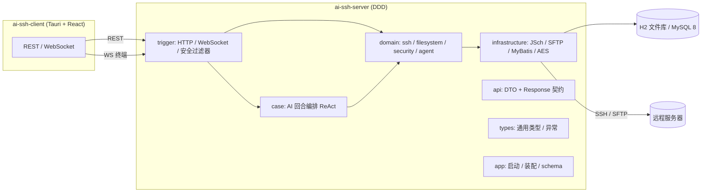

# AI SSH 服务端

智能 SSH 运维平台的服务端：对外提供 **SSH 连接管理、终端、远程文件、操作审计与 AI 运维助手** 能力，桌面端（[fengbaohuo1/ai-ssh-client](https://github.com/fengbaohuo1/ai-ssh-client)）通过 REST + WebSocket 接入。

- Spring Boot 4.1 + Java 17 + MyBatis-Plus，DDD 分层（api / domain / infrastructure / trigger / case / types / app）
- 存储双模式：`local`（H2 文件库，默认，零外部依赖）/ `server`（MySQL 8）
- AI：Google ADK 1.9 + Spring AI 2.0.1，支持 `deepseek-native` 原生通道与 `openai-compatible` 兼容通道，模型可在客户端设置页配置
- 安全：SSH 凭证 AES-256-GCM 加密落库、可选接口令牌鉴权、CORS 白名单、危险命令拦截、只读智能体命令级写拦截、全量操作审计

## 架构



| 模块 | 职责 |
|---|---|
| `ai-ssh-server-api` | DTO、`Response<T>` 契约、API 接口定义 |
| `ai-ssh-server-domain` | 领域模型、端口接口、领域服务（ssh / filesystem / security / agent），不依赖框架实现 |
| `ai-ssh-server-infrastructure` | JSch 会话与 SFTP、MyBatis-Plus DAO、AES 加解密、配置目录与文件存储 |
| `ai-ssh-server-trigger` | REST 控制器、WebSocket 终端端点、安全过滤器 |
| `ai-ssh-server-case` | AI 回合编排（ReAct 节点链路：思考 → 工具 → 反馈 → 决策） |
| `ai-ssh-server-types` | 通用类型、响应码、`AppException` |
| `ai-ssh-server-app` | 启动类、Spring 配置、YAML 智能体装配、内置技能资源 |

## 核心能力

### SSH 会话与命令执行

- 统一会话层：`ChannelShell` 供人机共用终端（WebSocket `/ws/terminal/{connectionId}`），`ChannelExec` 供 AI 工具专用，两者按 `connectionId` 隔离。
- **结构化执行结果**：`execCommandDetailed` 返回 stdout / stderr / exitStatus / timedOut / truncated；成功判定以退出码优先（无退出码时回退文本分析），stderr 不再丢失。
- **超时与输出上限**：`ai.ssh.exec.timeout-seconds`（默认 300s）、`ai.ssh.exec.max-output-bytes`（默认 262144，超出按 head/tail 保留并标记 truncated）；超时/取消会中断上游订阅，避免"超时了但命令还在跑"。
- 凭证 AES-256-GCM 加密（`enc:v1:` 前缀），接口永不回传明文；文件路径统一闸门（拒绝目录穿越、控制字符、超长路径与 `/proc`、`/sys`、`/dev` 等敏感目录）。

### AI 智能体

- ADK 装配链：`RootNode → ChatModelNode → AgentNode → AgentWorkflowNode → RunnerNode`，`RootNode` 负责会话与终端绑定，`AiCallNode` 调模型，`ToolCallNode` 执行工具，`UserFeedbackNode` 回合收口。
- 所有配置来自 `${AI_SSH_HOME}/config/agent.yml` + `llm.yml` 覆盖层，支持 **保存即热重装**（无需重启）。
- **派发模式 `delegate-mode`**（声明了 `sub-agents` 的智能体）：
  - `hybrid`（默认）：同时持有执行工具与派发工具，简单命令自己做，复杂/可并行任务再派发；
  - `dispatch-only`：只持有派发工具，父智能体不接触终端（强隔离）。
- **派发预算**（运行时强制）：每轮最多 2 次派发、子任务合计 6 个、同一子智能体 4 个任务、同任务描述去重；子会话不具备派发能力；超限直接返回可读原因，避免"过度派发 / 套娃"。
- **执行痕迹**：子智能体结果尾部附 `[子智能体执行痕迹]`（最多 15 条 / 1500 字符，逐条命令 + 成败 + 退出码），父智能体据此避免重复执行。
- **只读命令级拦截**：`read-only: true` 的智能体不挂载写入工具，且 `executeCommand` 用 `CommandGuard.isMutating` 在命令级拦截写操作（命令起始锚定 + `xargs` / `find -exec` 间接执行覆盖，尽量不误杀 `last reboot`、`grep reboot` 这类参数动词）。
- **MCP 工具**：`tool-mcp-list` 挂载的 MCP 工具默认只给非只读智能体；只读智能体确认只读安全时可加 `mcp-readonly-safe: true` 放行。热重装会回收旧 MCP 工具集。
- **回合治理**：悬挂工具步在回合收口时补发 `missing_result` 结果（前端不再一直 running）、SSE 断连可取消、动态上下文后缀有字符预算、环境采集按连接缓存 3 秒。

### 配置生命周期

保存 `agent.yml` / `llm.yml` 走 **校验 → 备份 → 原子写 → 装配成功才切换**：YAML 结构、provider/model、`delegate-mode`、`sub-agents` 引用、`runner.agent-name` 等前置校验失败直接拒绝（不落盘、不产生 `.bak`）；热重装失败时保留旧装配继续服务，接口返回 `applied=false` + 原因。

## 快速开始

### 环境要求

- JDK 17、Maven 3.9+
- 无外部依赖：默认 `local` profile 使用 H2 文件库

### 本地跑通（H2，零依赖）

```bash
cd ai-ssh-server
mvn -pl ai-ssh-server-app -am spring-boot:run
# 或打包后运行
mvn -DskipTests package
java -jar ai-ssh-server-app/target/ai-ssh-server-app.jar --spring.profiles.active=local
# 默认 http://localhost:8091
```

首次启动会创建 `${AI_SSH_HOME}`（默认 `~/.ai-ssh`）：`data/` 为 H2 库、`config/` 放 `agent.yml` 与 `llm.yml`、`logs/` 放日志。没有配置 LLM API Key 时服务仍能正常启动，智能体装配跳过并提示，补全配置后保存即生效。

### MySQL 部署

```bash
java -jar ai-ssh-server-app/target/ai-ssh-server-app.jar --spring.profiles.active=server
```

- 连接通过环境变量注入：`AI_SSH_DB_URL` / `AI_SSH_DB_USERNAME` / `AI_SSH_DB_PASSWORD`。
- 表结构由脚本维护（`server` profile 不执行 DDL）：

```bash
# 新库
mysql -h <host> -P <port> -u root -p ai_ssh < docs/dev-ops/mysql/sql/init.sql
# 已有库按版本升级
mysql -h <host> -P <port> -u root -p ai_ssh < docs/dev-ops/mysql/sql/migration-v2.sql
mysql -h <host> -P <port> -u root -p ai_ssh < docs/dev-ops/mysql/sql/migration-v3.sql
```

### 与前端联调

客户端（桌面端或 `npm run dev`）默认把 `/api` 代理到 `http://localhost:8091`；桌面端会复用已在 8091 起的后端。

## 配置

### agent.yml 结构

```yaml
ai:
  agent:
    config:
      enabled: true
      tables:
        sshAgent:
          app-name: sshAgent
          agent:
            agent-id: 100004
            agent-name: SSH AI Agent
            agent-desc: SSH 智能运维助手
          module:
            chat-model:
              provider: deepseek-native        # deepseek-native | openai-compatible
              base-url: https://api.deepseek.com
              api-key: ${AI_SSH_LLM_API_KEY:}  # 也可在客户端设置页写入 llm.yml
              model: deepseek-flash
              context-size: 128000
              reasoning-effort: High
              temperature: 0.3
              top-p: 0.95
              max-tokens: 8192
              tool-mcp-list:                   # 可选：MCP 工具
                - remote:
                    name: llm-gateway
                    url: http://127.0.0.1:8790/mcp
                    request-timeout: 30000
            agents:
              - name: sshOperator              # 编排者
                description: SSH 编排智能体
                delegate-mode: hybrid          # hybrid（默认）| dispatch-only
                sub-agents: [sshDiagnosisAgent, sshChangeAgent]
                instruction: |
                  你是 SSH 智能运维助手……
                output-key: ssh_result
              - name: sshDiagnosisAgent        # 只读诊断专家
                description: SSH 故障诊断子智能体
                read-only: true                # 不挂载写入工具 + 命令级写拦截
                instruction: |
                  只执行只读诊断命令……
              - name: sshChangeAgent           # 变更专家
                description: SSH 变更执行子智能体
                read-only: false
                instruction: |
                  执行明确的变更任务……
            runner:
              agent-name: sshOperator
              plugin-name-list: [myTestPlugin]
```

`llm.yml` 是覆盖层（客户端设置页写入），同名键覆盖 `agent.yml` 中的值，**不会重写** `agent.yml` 的注释与结构。

### 关键配置项（application.yml）

```yaml
ai:
  ssh:
    exec:
      timeout-seconds: 300        # AI 工具单条命令执行超时
      max-output-bytes: 262144    # AI 工具单条命令输出上限（超出按 head/tail 保留并标 truncated）
  security:
    auth-enabled: false           # 接口令牌鉴权（server profile 默认 true）
    credential-key: ${AI_SECURITY_CREDENTIAL_KEY:}
    api-token: ${AI_SECURITY_API_TOKEN:}
    allowed-origins: [http://localhost:1420]
    sftp:
      max-upload-bytes: 104857600
      max-preview-bytes: 262144
      blocked-paths: [/proc, /sys, /dev]
    audit:
      enabled: true
```

### 环境变量

| 变量 | 说明 |
|---|---|
| `AI_SSH_HOME` | 应用数据目录，缺省 `~/.ai-ssh`（`data/` `config/` `logs/`） |
| `AI_SSH_PROFILE` | 存储模式：`local`（默认，H2）/ `server`（MySQL） |
| `AI_SSH_DB_URL` / `AI_SSH_DB_USERNAME` / `AI_SSH_DB_PASSWORD` | `server` profile 的 MySQL 连接 |
| `AI_SSH_LLM_API_KEY` | `agent.yml` 中 `api-key: ${AI_SSH_LLM_API_KEY:}` 的环境变量入口 |
| `AI_SECURITY_CREDENTIAL_KEY` | AES-256-GCM 主密钥（Base64 / hex / ≥32 字节原文），丢失将无法解密存量凭证 |
| `AI_SECURITY_API_TOKEN` / `AI_SSH_AUTH_ENABLED` | 接口令牌与鉴权开关 |
| `SERVER_PORT` | 服务端口，默认 8091 |
| `AI_SSH_MANUAL_SSH` | 设为 `true` 才会运行需要真实 SSH 凭据与控制台输入的手工测试类 |

## 主要 API

| 方法 | 路径 | 说明 |
|---|---|---|
| GET | `/api/v1/system/health` | 健康检查（body `status=UP`） |
| GET | `/api/v1/system/overview` / `/security` | 运行概览 / 安全姿态 |
| GET/POST/PUT/DELETE | `/api/v1/ssh/connection/**` | 连接 CRUD、connect / disconnect、分组 |
| GET | `/api/v1/sftp/{connectionId}/list\|stat\|preview\|download` | 文件浏览 / 属性 / 预览 / 下载 |
| POST | `/api/v1/sftp/{connectionId}/mkdir\|rename\|delete\|write\|upload` | 文件写操作（`rename` 同时承担移动） |
| GET | `/api/v1/audit/logs` / `/actions` | 审计分页与动作字典 |
| POST | `/api/v1/chat_stream` | AI 流式对话（SSE 步骤协议） |
| GET | `/api/v1/query_ai_agent_config_list` | 智能体配置（工具清单 / `delegate-mode` / 只读边界 / 告警） |
| GET/PUT | `/api/v1/agent/config/model` | 模型配置（写 `llm.yml` 覆盖层，apiKey 只写不回显） |
| GET/PUT | `/api/v1/agent/config/file` | Agent 主配置 `agent.yml`（校验 + `.bak` + 原子写） |
| POST | `/api/v1/agent/config/reload` | 手动热重装智能体 |
| WS | `/ws/terminal/{connectionId}` | 终端会话（创建 `ChannelShell`，AI 工具依赖该会话存在） |

## 测试

```bash
cd ai-ssh-server

# 核心单测（凭证加密 / 路径闸门 / 命令守卫与只读拦截 / 模型通道 / 会话治理 / 智能体装配）
mvn -pl ai-ssh-server-app -am \
  "-Dtest=AesGcmCredentialCipherTest,RemotePathResolverTest,CommandGuardTest,CommandOutcomeAnalyzerTest,ProviderCapabilitiesTest,ChatModelFactoryTest,EventGovernorTest,CompactionSupportTest,SessionStoreTest,TaskStateMachineTest,SessionHistoryReplayerTest,ChatHistoryRepositoryTest,DispatchBudgetTest,AgentConfigValidatorTest,SubAgentResultExtractorTest" \
  "-Dsurefire.failIfNoSpecifiedTests=false" test
```

需要真实环境的测试默认跳过或失败：`SshSessionPortManualTest` 需 `AI_SSH_MANUAL_SSH=true` 且控制台输入密码；涉及真实 LLM / SSH 的集成测试需要可用的 API Key 与服务器。

## 目录结构

```
ai-ssh-server/
├── ai-ssh-server-api/            # DTO / Response / API 契约
├── ai-ssh-server-domain/         # 领域模型 + 端口接口 + 领域服务
│   ├── ssh/                      # 连接聚合 / 统一会话端口 / 结构化执行结果
│   ├── filesystem/               # SFTP 值对象 / 端口 / 路径闸门
│   ├── security/                 # 凭证加解密 / 审计 / 安全配置
│   └── agent/                    # ADK 装配 / 工具 / 上下文治理 / 模型通道档案 / 派发预算
├── ai-ssh-server-infrastructure/ # JSch / SFTP / MyBatis / AES 适配器 + 配置存储
├── ai-ssh-server-trigger/        # HTTP 控制器 / WebSocket / 安全过滤器
├── ai-ssh-server-case/           # AI 回合编排（ReAct 节点链路）
├── ai-ssh-server-types/          # 通用类型 / 响应码 / 异常
├── ai-ssh-server-app/            # 启动 + 配置 + YAML 智能体 + 内置技能
│   └── src/main/resources/
│       ├── application-local.yml     # H2 本地模式（默认）
│       ├── application-server.yml    # MySQL 部署模式
│       ├── db/schema-h2.sql          # 本地库幂等建表
│       └── agent/ssh-agent.yml       # 智能体配置模板
└── docs/dev-ops/mysql/sql/       # MySQL 建表与版本迁移脚本
```

## 相关仓库

- 客户端：[fengbaohuo1/ai-ssh-client](https://github.com/fengbaohuo1/ai-ssh-client)
- 开发约定见仓库内 `AGENTS.md`（模块边界、命名规范、测试与配置变更注意事项）。
